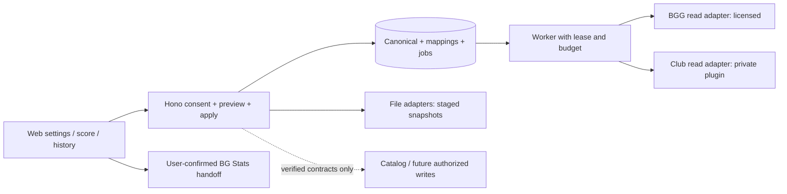

# Kiến trúc đề xuất

Trạng thái: proposal sau nghiên cứu 2026-10-16; chưa implementation approval. [Scope](SCOPE.md), [feasibility](FEASIBILITY.md), [roadmap](PLAN.md).

## Các phương án

| Phương án | Coverage và độ tin cậy | Chi phí/bảo trì | Phụ thuộc |
|---|---|---|---|
| A: BGG hub | Đơn giản cho subset public; mất score sheets/teams/roles; không có public write cho OnBoardVN | Ít adapter ban đầu nhưng reconciliation/loss handling vẫn khó | BGG license, availability, ID model; không đạt two-way đầy đủ |
| B: canonical + adapters | Giữ metadata phong phú, capability riêng mỗi provider; file/link có thể khác mức tự động | Nhiều contract fixtures và mapping; adapters cô lập thay đổi | Mỗi provider, nhưng sự cố một bên không chặn toàn hệ thống |
| Hybrid đề xuất | Canonical + adapters, BGG là nguồn metadata/import có điều kiện; link/file cho BG Stats; Catalog/club evidence-gated | Triển khai từng capability, không dựng sync engine quá lớn ngay | Không coi BGG là đường truyền mọi dữ liệu hoặc proxy công khai |

## Quyết định đề xuất và giới hạn

Chọn hybrid làm hướng nghiên cứu triển khai: PostgreSQL/Hono/shared scorer hiện có, provider capabilities có read/write/data-class/automation/authorization tách biệt. Chưa thêm Redis hoặc queue framework; persisted PostgreSQL jobs/leases có thể đủ giai đoạn đầu. Web framework cần chủ project chọn sau parity inventory, không suy diễn web-first thành Next.js hay Expo.

Không dựa UI automation của app bên thứ ba để production sync. BGG approval, quyền normalization/onward export và upstream private club contracts là gate; adapter disabled rõ lý do khi chưa đủ. Raw/source provenance tách khỏi user fields nhưng không tự cấp quyền tái sử dụng BGG data.



## Canonical model: extend existing owners

Không tạo duplicate games/users/plays. Migrations tương lai tuần tự, backup và restore-check trước schema/data change.

| Entity | Existing owner / proposed fields |
|---|---|
| Game | games UUID/BGG ID/canonicalId/variantOfId; thêm edition/expansion relations phân biệt game vs version, aliases có provenance |
| Collection item | Mở rộng shelf hoặc relation riêng sau schema design: owner, game/edition, copy UUID, owned/wishlist/status, rating/note/tags và visibility; không collapse nhiều copies thành user/game |
| Session/play | Existing plays UUID; date precision/date-only + timezone knowledge, duration, location, notes/tags/attachments, source-owned final score mode, privacy, soft delete và rev |
| Participant/result | Existing identities/play seats; external identity scoped provider/account/club; score raw text + typed numeric nếu hợp lệ, rank, winner, team/role/start-player, detailed rounds/template version |
| Integration connection | user/club scope, provider, public username vs verified ownership, consent scopes/directions, authorization kind, capability snapshot, disabled/revoked state; secrets referenced server-side |
| External mapping | UNIQUE(provider, connection, entity kind, external ID) identifies source record; mapping links attach canonical IDs with relation/group/split position. Support many source records → one physical session and one quantity record → multiple explicitly linked sessions; namespaces/account owners độc lập |
| Source record | mapping, remote revision/modification time/hash, observed/fetched timestamps, last successful full scope, provenance, payload retention policy/permission, deleted observation |
| Sync run/job | actor, scope, immutable preview hash, checkpoints, attempt/next-run/lease, status, sanitized error; outbox only for licensed writes; no raw participant data in logs |
| Conflict/field state | baseline/local/source value or restricted reference, source provenance, resolution, acknowledgement hash; scoped permissions |

Imported historical score-only plays phải có representation riêng, không bịa template categories hoặc recompute sai. Preserve source score strings và date-only records; thiếu numeric score không đồng nghĩa 0. The Gang giữ cooperative outcome. Canonical finalization cho user-scored plays vẫn server-authoritative theo engine hiện tại.

Attachments cần storage authorization/retention contract riêng; MVP chỉ giữ references được phép, không tự tải hoặc xuất ảnh. Ratings/tags/notes cá nhân tách khỏi BGG metadata và shared club fields.

## Identity, merge và conflict

1. Parse/validate versioned provider envelope into staging; distinguish absent vs explicit null. Retain unknown fields only where permitted, bounded and private.
2. Same-source stable mapping → upsert. BG Stats file-local numeric refs chỉ giải reference trong snapshot; UUID là identity, không regenerate khi export.
3. Cross-source stable explicit ID/link có thể đề xuất chung session; tên game/điểm/ngày không bao giờ unique tuyệt đối. Fingerprints chỉ xếp hạng candidate; preview cần user confirm.
4. Physical session shared nhiều người có thể có nhiều BGG reporting copies. Không cấp creator/participant ownership từ username hoặc nickname; guest linking cần consent và club gates.
5. Three-way field comparison với baseline: source-only change apply nếu scope cho phép; local-only giữ; cả hai đổi khác nhau → conflict. MVP manual resolution, không last-write-wins mặc định.
6. Source of truth do user chọn theo provider/field group: local scoring details, source collection status, shared session participants. Không cho actor chọn ownership của dữ liệu người khác. Timestamp mới hơn chỉ dùng khi provider contract có định nghĩa đáng tin.
7. Retain superseded mapping aliases và merge audit. Recheck permissions/rev khi apply; preview stale phải tính lại.
8. Snapshot thiếu/partial page không phải tombstone. Chỉ nghi remote deletion sau complete successful scope; review before local removal. Third-party deletes không gửi khi chưa contract và confirmation riêng.

## Idempotency, concurrency và loops

Unique source record + mapping-link UNIQUE(sourceRecordId, relation, splitPosition) với stable child IDs + transactional apply + revision compare-and-swap bảo đảm retries/concurrent workers không tạo duplicate split sessions. Jobs có lease hết hạn, retry bounded, at-least-once delivery. Hash normalized observations và applied origin/revision; không tạo outbox khi chỉ nhận lại observation đã acknowledged. Never invent upstream acknowledgement from link launch.

BG Stats handoff state: prepared → handed-off → user-reported-confirmed (không phải verified receipt). Mất tab hoặc timeout giữ trạng thái ambiguous, không tự resend. Future remote API receipts phải lưu ID/revision trước job complete; response-lost retry chỉ khi provider supports idempotency hoặc reconcile trước.

BGG polling cần full reconciliation định kỳ để bắt old edits/deletes; modifiedsince collection không bao gồm deletion. Full scan partial không advance complete cursor. Per-connection/per-app throttling, Retry-After, backoff+jitter, bounded 202 waiting, 401/403 action-required. Không giả định fixed rate quota.

```mermaid
sequenceDiagram
  actor User
  participant Web
  participant API
  participant DB
  User->>Web: Select file/provider and scope
  Web->>API: Stage snapshot or licensed read
  API->>DB: Save scoped preview + baseline revisions
  API-->>Web: Changes, matches, conflicts, losses
  User->>Web: Confirm selected changes
  Web->>API: Apply preview ID/hash
  API->>DB: Recheck access/revisions, atomic upsert + mappings
  API-->>Web: Applied or stale-preview conflict
  User->>Web: Push chosen play to BG Stats
  Web-->>User: Privacy/loss/Auto-post notice + explicit link
  Note over Web,API: Link launch is no success receipt; no automatic resend
```

BG Stats inbound BGG import chỉ thêm unknown plays, không update existing. Đây không phải file-import update contract. Quantity splitting cần explicit grouping/one-to-many mapping links; BGG source quantity giữ nguyên cùng provenance, không tự suy ra nhiều physical sessions từ fingerprint. Optional comments chứa expansion/variant chỉ là text, không tự parse thành authoritative game state.

## UX Android và web

Settings → Integrations: nguồn, scopes/directions/capabilities, last attempt vs last successful sync, action-required reason, history, preview, conflicts, retry, disconnect, imported-data removal và export. BGG username UI ghi rõ public import/unverified ownership, không OAuth.

Desktop web có QR cho first-party review page được access-control, short-lived; phone user review rồi tap BG Stats link. Không nhét PII/notes vào QR analytics hoặc log query. Browser không biết chắc app đã cài; fallback hướng dẫn supported links hoặc file đã qua PoC. Native intents chỉ phát triển sau web acceptance.

Disconnect dừng jobs/thu hồi secrets nếu có, giữ dữ liệu theo lựa chọn. Remove imported data chỉ xóa source links/local personal records theo quyền; shared plays không cascade mất dữ liệu người khác. Export phải có field/privacy/license preview; không đưa external login IDs, private roster hay source secrets vào file/link.

## Reliability và rollback

Staging dry-run không commit canonical data; apply dùng transaction + import batch audit. Rollback chỉ revert fields còn ở revision do batch tạo, không đè edits sau đó. Private payload retention/expiry, encryption secret storage server-side và backup theo deployment docs; logs chỉ IDs/counts/status. API ngừng hoặc revoke: pause adapter, giữ local records/export khả dụng. Scheduler/worker shutdown cleanly; không chạy background process trong research.

## Open decisions

Web framework/parity, allowed BGG transformations, current file schemas, per-provider result update semantics, participant consent and printing content rights/assets. Các quyết định này là gate trong [PLAN.md](PLAN.md).
